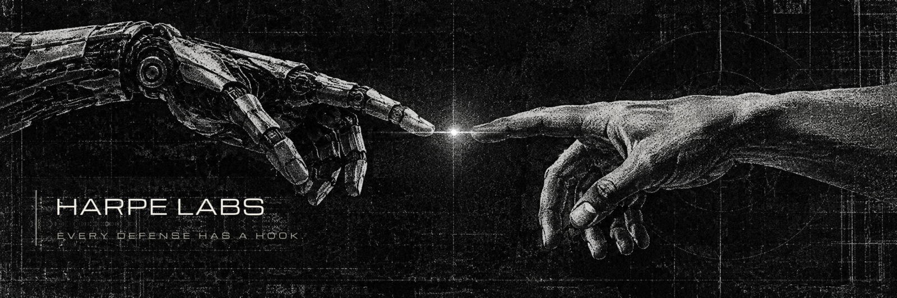

  

  <strong>An independent security research collective.</strong> 
  Web3 · AI · Applied offensive research

  
  

---

## About us

Harpe Labs is a team of independent security researchers. We break systems so that the people who own them don't find out the hard way.

We are not a compliance shop. We don't deliver a checklist and a PDF of tool output. We work the way an attacker works — on the assumption that the system was built by competent people, and that the way in is somewhere nobody thought to look.

**The name.** The *harpe* is the hooked sickle-sword of Greek myth — the blade Perseus was given to kill Medusa, a target you cannot even face directly. The hook is the point of it: it catches the shield and drags the defense out of position, and only then does the blade do its work. That is the method. We don't attack hardened surfaces head-on. We find the hook.

**Every defense has a hook.**

## What we do

| Domain | Scope |
|---|---|
| **Smart contract security** | EVM / Solidity, Solana / Anchor, Move / Aptos, TRON. Protocol logic, economic and MEV attack paths, upgrade and access-control flaws, cross-chain and bridge assumptions. |
| **AI / ML security** | Prompt injection and tool-call abuse, agent and RAG pipeline compromise, model supply chain, data exfiltration through inference, guardrail bypass in production LLM systems. |
| **Web & API** | Authentication and authorization logic, business-logic abuse, server-side request forgery, chained low-severity findings that compose into critical ones. |
| **Infrastructure review** | Key management, signer and multisig process, deployment pipelines, the operational gaps between a secure contract and an insecure org. |

## Our aim

To make exploitation uneconomical for the systems we work on — by finding the issue first, proving it with a working path, and making sure it is fixed rather than filed.

## Our objectives

- **Proof over speculation.** Every finding ships with a reproduction. If we can't demonstrate it, we don't claim it.
- **Impact over volume.** One critical with a clear exploit path is worth more than forty informational findings. We don't pad reports.
- **Fix-oriented reporting.** A finding is not closed when it is reported. It is closed when the remediation is verified.
- **Research that outlives the engagement.** Novel findings become public writeups and tooling once disclosure is complete, so the next team doesn't have to rediscover them.
- **Build the pipeline for emerging surfaces.** AI systems are being shipped faster than they are being secured. We invest research time there ahead of demand.

## Where we work

Active across public and private programs on **HackerOne**, **Bugcrowd**, **Immunefi**, **Intigriti**, **HackenProof**, and **Cantina**, alongside direct client engagements.

## Open for audit

We are currently **taking engagements**. We work with:

- Protocols shipping a new contract system or a major upgrade
- Teams deploying LLM agents with real tool access, funds, or user data
- Projects that have already been audited and want an adversarial second pass
- Pre-launch teams who want a researcher in the room before the code freezes, not after

**What an engagement looks like**

1. **Scope** — we review the codebase, threat model, and what the system is actually protecting. You get a flat quote and a timeline before any money moves.
2. **Research** — manual review first, tooling second. We work against the system's own assumptions.
3. **Report** — findings with severity, reproduction steps, impact analysis, and concrete remediation.
4. **Verification** — we re-test every fix. No finding closes on your word or ours alone.

**Get in touch**

| | |
|---|---|
| Audit inquiries | [YOUR EMAIL] |
| Security disclosures | [YOUR SECURITY EMAIL] |
| X / Twitter | @harpelabs |
| Telegram | [YOUR HANDLE] |

> If you are reporting a vulnerability in something we maintain, email the disclosure address above. We respond within 48 hours and we do not pursue researchers acting in good faith.

---

  <strong>HARPE LABS</strong> · Every defense has a hook.

